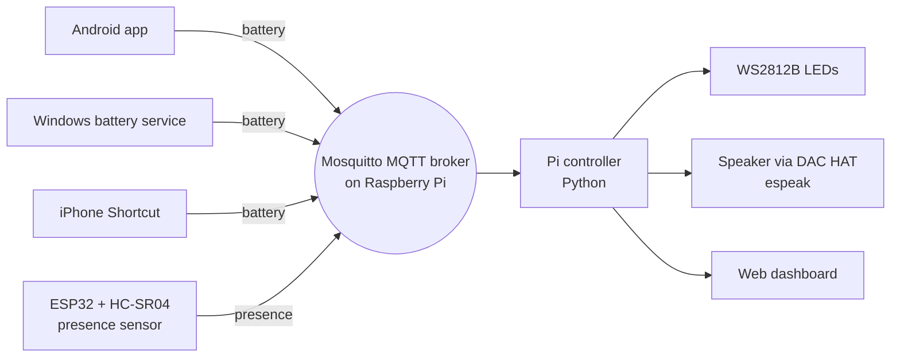

# ChargeSense: Smart Multi-Device Charging Station

A charging station that knows which of your devices need power. Phones, laptops, and accessories report their battery levels over MQTT; the station shows each device's status on LEDs, detects when you walk up, and tells you out loud what needs charging.

Built as a senior capstone project at RPI.

📁 Full write-up, photos, and my role: [Portfolio](https://bit.ly/charity-osoro-portfolio)

Team repo (RPI IoT course): [rpi-iot-projects/2026-Team-14-Smart-Charging-Station](https://github.com/rpi-iot-projects/2026-Team-14-Smart-Charging-Station)

## Features

- **Live battery tracking** for Android, Windows laptops, and iPhone (via Shortcuts) over MQTT
- **Per-device status LEDs** (WS2812B): green when fine, orange under 50%, red under 25%
- **Presence detection** with an ESP32 + HC-SR04 ultrasonic sensor, so the station reacts when someone approaches
- **Spoken alerts** through a DAC HAT using espeak ("Your laptop is at 20 percent")
- **Scheduled reminders** for devices that stay low
- **Web dashboard** (PWA) showing every device's battery at a glance

## Architecture

**MQTT topics**

| Topic | Payload |
|---|---|
| `<prefix>/devices/battery/<device>` | `{"device", "percent", "plugged", "timestamp"}` |
| `<prefix>/ranger/presence` | presence detected / cleared |
| `<prefix>/devices/event/<device>` | device events |

## Repository layout

| Folder | Contents |
|---|---|
| `on_pi/charging_station/` | Main Pi controller, battery server (Flask, runs as a systemd service), MQTT publisher |
| `Pi_Scripts/` | Earlier controller and speaker test scripts |
| `Arduino_Sketches/` | ESP32 presence sensor (`mqtt_ranger`), LED tests, vendored PubSubClient |
| `Laptop_Scripts/` | Windows battery publisher and background service |
| `Android_Scripts/` | Android battery reporter APK |
| `Dashboard-UI/` | Battery Hub web dashboard (PWA) |

## Hardware

- Raspberry Pi (MQTT broker + controller)
- ESP32 with HC-SR04 ultrasonic sensor
- WS2812B addressable LEDs
- DAC HAT + speaker for audio output

## Testing without devices

To send data manually: 
mosquitto_pub -h 10.143.170.254 -t OSOROC/devices/battery/android -m '{"device":"SM-S938U1","perc
ent":26,"plugged":false,"timestamp":"04:20:15:50:00"}'

## My role

I built the Raspberry Pi controller, the battery server, and the ESP32 presence-detection ("Ranger") unit, and brought the system to a working end-to-end state. My teammate built the LED controller and the Android/PC battery scripts.

## License

See [LICENSE](LICENSE).
